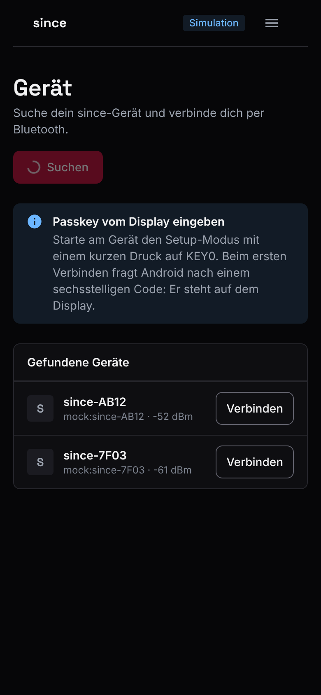

# since – Android-App

Die App richtet ein since-Gerät per Bluetooth LE ein: Name, Anlass, Datum und Uhrzeit des
Ereignisses, Zeitzone, Layout, Aktualisierung, WLAN/NTP und Portal-Schutz. Sie überträgt die
Uhrzeit des Handys, zeigt den Status und beendet den Setup-Modus. Das Webportal des Geräts
bleibt als Weg ohne App erhalten; Firmware-Updates und Werksreset gibt es nur dort bzw. am Gerät.

Technik: Angular 22, [zenit-ui](https://www.npmjs.com/package/@zenit-hosting/zenit-ui) als
Komponentenbibliothek, Capacitor 8 (Android) und `@capacitor-community/bluetooth-le`.
Der BLE-Vertrag steht in [`docs/ble-protocol.md`](../docs/ble-protocol.md).



## Voraussetzungen

| Werkzeug | Version | Wofür |
|---|---|---|
| Node.js | aktuelle LTS (22 oder 24) mit npm | Build, Tests, Entwicklungsserver |
| JDK | 21 | Gradle-Build der Android-App |
| Android SDK | Platform 36, Build-Tools, Platform-Tools | APK bauen und installieren |

Das Android SDK kommt am einfachsten mit Android Studio oder den „Command-line tools“. Die
Variable `ANDROID_HOME` (oder `sdk.dir` in `android/local.properties`) muss darauf zeigen.

## Befehle

Alle Befehle im Ordner `app/`:

```sh
npm ci                     # Abhängigkeiten exakt nach package-lock.json
npm start                  # Entwicklungsserver auf http://localhost:4200 mit simuliertem Gerät
npm run build              # Produktions-Build nach dist/since-app/browser
npm test                   # Unit- und Kontrakttests (Vitest, headless)
npm run android:sync       # Build + Web-Assets und Plugins ins Android-Projekt kopieren
```

Debug-APK bauen (nach `npm run android:sync`):

```sh
cd android
./gradlew assembleDebug    # Windows: gradlew.bat assembleDebug
```

Die APK liegt danach unter `android/app/build/outputs/apk/debug/app-debug.apk`.

## APK installieren

1. Am Handy unter Einstellungen → Über das Telefon siebenmal auf „Build-Nummer“ tippen, dann in
   den Entwickleroptionen „USB-Debugging“ einschalten.
2. Handy per USB verbinden und `adb install -r android/app/build/outputs/apk/debug/app-debug.apk`
   ausführen. Alternativ die APK aufs Handy kopieren und dort öffnen („Installation aus
   unbekannten Quellen“ erlauben).
3. Oder direkt aus Android Studio: `npx cap open android`, dann „Run“.

Beim ersten Start fragt Android nach der Berechtigung „Geräte in der Nähe“. Ab Android 12 braucht
die App keinen Standort (`neverForLocation`); bis Android 11 verlangt das System für BLE-Scans
die Standortberechtigung.

## Einrichten eines Geräts

1. Am Gerät kurz KEY0 drücken: Der Setup-Modus startet, das Display zeigt einen Passkey.
2. In der App „Suchen“, dann „Verbinden“. Beim ersten Mal fragt Android im System-Dialog nach dem
   sechsstelligen Passkey vom Display.
3. Einstellungen ändern und speichern, unter „Uhrzeit“ die Uhrzeit vom Handy übernehmen.
4. Unter „Status“ „Setup beenden“: Das Gerät schaltet Bluetooth und Hotspot aus und zeichnet neu.

## Architektur

```
src/app/
├── core/
│   ├── config/        Config-Modell, Validierung, POSIX-TZ-Parser, Kalender (Port von since_core)
│   ├── protocol/      UUIDs, Ops, Fehlercodes, Framing, RpcChannel (id-Zuordnung, Timeouts)
│   ├── transport/     DeviceTransport, BleTransport, MockTransport, MockDevice
│   ├── device.service.ts   Verbindungszustand und Operationen als Signals
│   ├── messages.ts    deutsche Texte für Validierungs- und Fehlercodes
│   └── format.ts      Datums- und Zahlenformate
├── connect/           Seite „Gerät“: suchen, verbinden, trennen
├── settings/          Seite „Einstellungen“ (Signal Forms) und Formular-Modell
├── time/              Seite „Uhrzeit“: Handy- und Gerätezeit, setTime
└── status/            Seite „Status“: Akku, RTC, Synchronisierung, Setup beenden
```

**Transport.** Die Seiten kennen nur `DeviceService`, der über das Interface `DeviceTransport`
spricht. Es gibt zwei Implementierungen:

- `BleTransport` nutzt `@capacitor-community/bluetooth-le`: Scan nach der Service-UUID,
  Verbinden, Kopplung per `createBond()` (Android fragt den Passkey ab), Notifications auf `tx`,
  Schreiben auf `rx`.
- `MockTransport` simuliert ein Gerät im Browser. Anfragen laufen durch dieselbe Stückelung und
  denselben `RpcChannel` wie bei BLE in ein `MockDevice`, das die Config mit derselben Logik
  prüft wie die Firmware. So funktioniert `npm start` ohne Hardware.

Auswahl: Auf dem Handy (`Capacitor.isNativePlatform()`) BLE, im Browser die Simulation. Mit
`?transport=mock` oder `?transport=ble` in der URL lässt sich das überschreiben; die Wahl bleibt
in `localStorage` (`since.transport`).

**Framing.** Jeder Frame beginnt mit einem Flag-Byte (0x01 FIRST, 0x02 LAST), danach höchstens
MTU − 3 − 1 Bytes Nutzdaten. Ein FIRST-Frame verwirft eine halb empfangene Nachricht, Nachrichten
über 4096 Bytes werden verworfen. Das Android-Plugin handelt die MTU beim Verbinden selbst aus;
die App liest sie mit `getMtu()` und stückelt mit höchstens 247 (die MTU, die das Protokoll
vorsieht). `RpcChannel` vergibt die `id`, ordnet Antworten zu, schreibt die Frames einer Nachricht
am Stück und bricht nach 10 s mit `timeout` ab.

**Validierung.** `core/config/config.ts` und `tz.ts` sind ein Port von
`firmware/lib/since_core/src/config.cpp` und `tz.cpp`: Zeichenlängen in Unicode-Codepoints,
Byte-Längen in UTF-8, lokales ISO-Datum, POSIX-TZ, Intervall nur im Intervall-Modus, Passwort
leer oder 8 bis 63 Bytes, NTP nur mit SSID, nur Schema-Version 1. Die Einstellungsseite prüft
jede Eingabe damit, bevor sie sendet, und zeigt Fehler am Feld; Fehler, die das Gerät meldet,
landen ebenfalls am passenden Feld.

## Tests

`npm test` führt alle `*.spec.ts` mit Vitest aus:

- **Kontrakttests** (`core/config/config.spec.ts`): lesen jede Datei aus
  `../shared/fixtures/config/valid` und `/invalid`; gültige müssen angenommen, ungültige
  abgelehnt werden und die Config unverändert lassen, wie `firmware/test/test_config`.
- Port der Firmware-Tests für TZ und Config.
- Framing (Stückeln, Zusammensetzen, Randgrößen, FIRST verwirft Teilnachricht), RpcChannel
  (id-Zuordnung, Timeout, Abbruch), MockDevice, MockTransport und DeviceService.

Wer Felder oder Regeln ändert, ändert Firmware, App und Fixtures zusammen.

## Screenshots

Mit dem simulierten Gerät, Handy-Breite 390 px:
[Gerät suchen](../docs/previews/app-geraet-suchen.png),
[verbunden](../docs/previews/app-geraet-verbunden.png),
[Einstellungen mit Validierung](../docs/previews/app-einstellungen.png),
[Uhrzeit](../docs/previews/app-uhrzeit.png),
[Status](../docs/previews/app-status.png).
