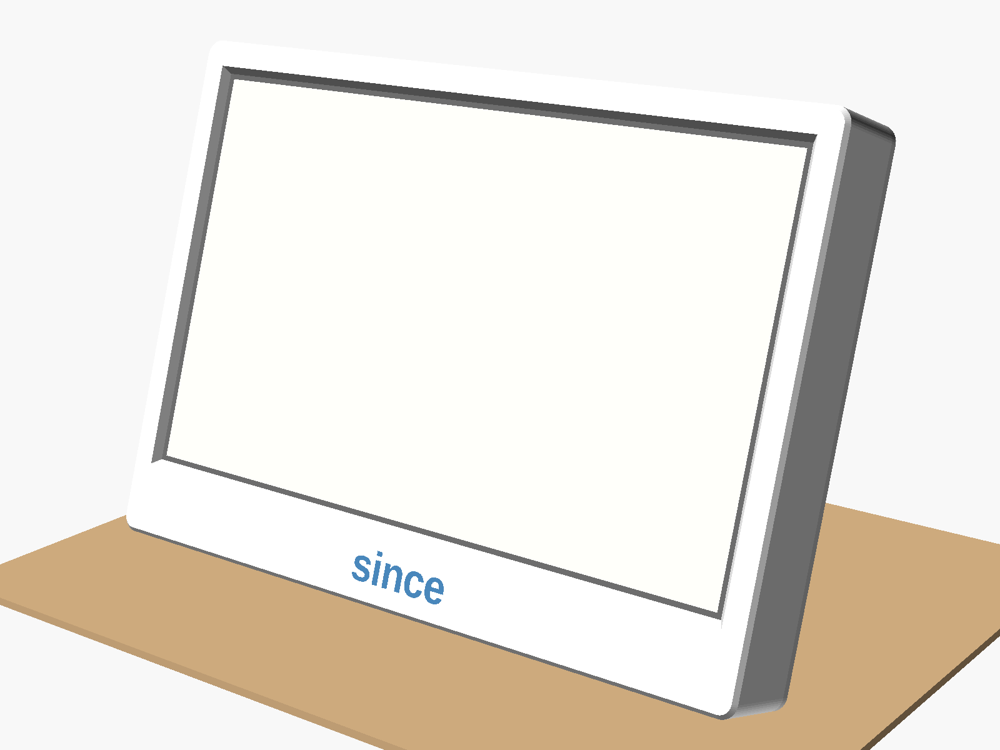
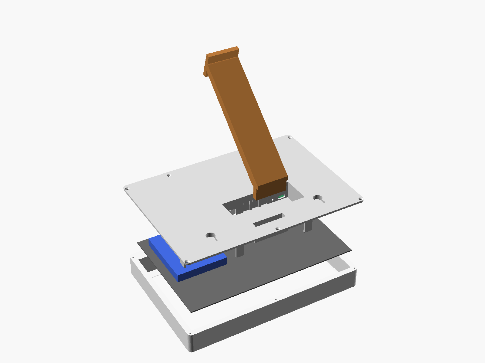
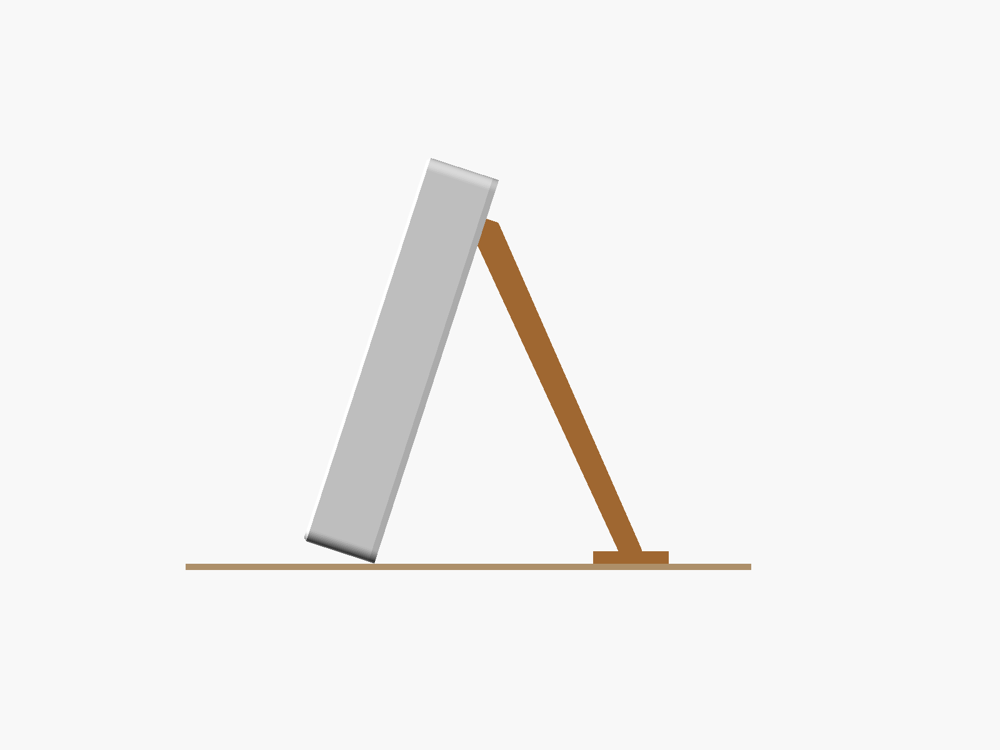

# Gehäuse

Parametrisches OpenSCAD-Gehäuse für **since**: ein Bilderrahmen für das 7,5″-E-Paper
(800 × 480) mit der Seeed-Platine „XIAO ePaper Display Board EE04“, LiPo-Akku und
DS3231-RTC. Es gibt auch eine Variante für das 4,2″-Panel. Gedruckt wird auf einem
Bambu Lab A1, P1 oder X1 (Bett 256 mm).



| Teil | Datei | Maße (7,5″) |
|---|---|---|
| Frontrahmen | `exports/since-7.5-front.stl/.3mf` | 181,8 × 128,3 × 21,8 mm |
| Namens-Einlage (AMS) | `exports/since-7.5-text.stl/.3mf` | je nach Text |
| Rückdeckel | `exports/since-7.5-back.stl/.3mf` | 181,8 × 128,3 × 19,7 mm |
| Aufsteller | `exports/since-7.5-stand.stl/.3mf` | 101 × 94 × 30 mm |
| Probedruck Service-Mulde | `exports/since-7.5-bay_test.stl/.3mf` | 87 × 51 × 19 mm |

Das Gerät ist zusammengebaut 23,8 mm tief. Die 4,2″-Variante liegt als
`exports/since-4.2-*` bei, Außenmaß 139 × 123,5 × 23,9 mm. Ihr Rahmen ist deutlich
breiter als das Panel, weil Platine, Akku und RTC dahinter Platz brauchen.

Die Exporte enthalten den Platzhalter-Namen
„since“. Für einen eigenen Namen die Teile neu exportieren (siehe unten).

Lizenz: [CC BY-SA 4.0](LICENSE)

## Aufbau



- **Frontrahmen.** Er wird mit der Sichtseite nach unten gedruckt. Die Frontplatte ist
  2 mm stark, das Fenster hat eine 45°-Fase. Dahinter liegt die Tasche für das Panel.
  Die Seitenwände gehen über die ganze Gehäusetiefe. Am Kinn unter dem Display sitzt
  der Namenszug, in der unteren Wand eine Aussparung für den Biegebereich des Panel-FPC.
  Der Rahmen hat 7 Schraublöcher für den Deckel.
- **Rückdeckel.** Er wird mit der Außenseite nach unten gedruckt.
  - Ein Zentrierkragen greift in den Rahmen.
  - Niederhalter drücken das Panel nach vorne.
  - Vier Säulen mit Zentrierstiften klemmen die EE04-Platine gegen Schaumstoffpads auf
    der Panel-Rückseite. Die Platine wird also nicht verschraubt.
  - Akku und RTC haben je ein Fach.
  - Für den Aufsteller gibt es eine Steckbuchse, dazu zwei Schlüssellöcher für die Wand.
- **Service-Mulde.** Das ist eine Vertiefung in der Rückseite direkt vor der Bedienkante
  der Platine. Ihre Wand zur Platine hat:
  - einen Durchbruch für den USB-C-Stecker,
  - einen Schlitz für den Ein/Aus-Schiebeschalter (mit Zahnstocher oder Stift schieben),
  - ein Ø 2-mm-Loch für Reset (Büroklammer),
  - drei gedruckte **Biegezungen** für die User-Taster. Mit `button_style="hole"` werden
    daraus Ø 3-mm-Löcher für einen Stift.

  Die Mulde ist nötig, weil das FPC des Panels nur 24 mm lang ist: Die Platine muss mit
  dem FPC-Stecker nah an der Panel-Unterkante sitzen. Dadurch liegt ihre Bedienkante
  (USB, Taster, Schalter) etwa in der Mitte des Geräts und nicht an einer Außenwand.
- **Aufsteller.** Er ist abnehmbar. Eine Zunge steckt senkrecht in der Buchse des Deckels.
  Das Gerät steht dann auf der hinteren Unterkante, um `stand_angle` (18°) nach hinten
  geneigt. Gedruckt wird der Aufsteller flach liegend, ohne Stützen und mit den Schichten
  in Lastrichtung.



## Dateien

| Datei | Inhalt |
|---|---|
| `since.scad` | Hauptdatei: alle Parameter (Customizer) und die Teileauswahl `part` |
| `lib/presets.scad` | Panelmaße und Innenaufteilung für 7,5″ und 4,2″, mit Quellen |
| `lib/ee04.scad` | Maße der EE04-Platine, mit Quellen |
| `lib/derived.scad` | abgeleitete Maße, Plausibilitätsprüfungen (`assert`) |
| `lib/front.scad`, `lib/back.scad`, `lib/stand.scad` | Geometrie der Teile |
| `lib/hardware.scad` | Dummies von Panel, Platine, Akku und RTC (nur für die Ansicht) |
| `export.sh` | exportiert alle Teile und rendert die Vorschaubilder |

## Exportieren

OpenSCAD ab 2021.01. Unter Debian/Ubuntu: `apt-get install openscad fonts-liberation`.
Für die PNG-Vorschauen auf einem Server ohne Bildschirm zusätzlich `xvfb`.

```sh
cd enclosure
./export.sh                      # 7,5″: STL + 3MF nach exports/, PNGs nach docs/previews/
./export.sh 4.2                  # 4,2″-Variante
NAME="Jürgen" ./export.sh        # eigener Namenszug (Umlaute gehen)
PREVIEWS=0 ./export.sh           # ohne Vorschaubilder
```

Einzelne Teile direkt exportieren:

```sh
openscad -D 'part="front"' -D 'name_text="Lotta"' -o front.3mf since.scad
openscad -D 'part="back"'  -D 'button_style="hole"' -o back.stl since.scad
```

`part` kann `front`, `back`, `stand`, `text`, `bay_test`, `all` (Baugruppe mit
Hardware-Dummies, `explode` für die Explosionsansicht) oder `standing` (nur Ansicht) sein.
`export.sh` bricht ab, wenn OpenSCAD eine Warnung meldet, ein `assert` fehlschlägt oder
CGAL ein Teil nicht als einfaches, geschlossenes Volumen („Simple: yes“) erzeugt.
Die Protokolle liegen in `build/`.

## Parameter

Alle Parameter stehen oben in `since.scad`. Im OpenSCAD-Customizer sind sie nach
Gruppen sortiert. Die wichtigsten:

| Parameter | Standard | Bedeutung |
|---|---|---|
| `display` | `"7.5"` | Preset `"7.5"` oder `"4.2"` |
| `name_text` | `"since"` | Namenszug, `""` = ohne |
| `name_font` | `"Liberation Sans:style=Bold"` | Schrift; sie muss Umlaute enthalten |
| `name_size` | 8 | Schriftgröße in mm |
| `name_style` | `"inlay"` | `inlay` (bündige Einlage, AMS), `engraved` (vertieft), `raised` (erhaben), `none` |
| `name_depth` | 0,6 | Tiefe oder Höhe des Reliefs; ein Vielfaches der Schichthöhe wählen |
| `rim` / `chin` | 5,5 / 11 | Rahmenbreite seitlich und oben / unten (Kinn) |
| `front_t` / `back_t` | 2,0 / 2,0 | Stärke von Frontplatte und Deckel |
| `panel_tol` | 0,3 | Spiel um das Panel je Seite |
| `tape_t` | 0,2 | Klebeband zwischen Panel und Rahmen |
| `window_reveal` | 0,5 | Fensterüberstand über die aktive Fläche je Seite |
| `wall` | 1,6 | Mindestwandstärke innerer Wände |
| `fit_tol` | 0,3 | Spiel für Deckel-Kragen und Aufsteller-Zunge |
| `screw_type` | `"selftap"` | `selftap` (Schraube direkt in Ø 1,7) oder `insert` (Gewindeeinsatz Ø 3,2) |
| `board_gap` | 2,5 | Abstand Panel-Rückseite zur Platinenunterseite (Schaumstoffpads) |
| `board_shift` | [0, 0] | Platine verschieben, falls das FPC nicht passt |
| `bay_len` | 28 | Länge der Service-Mulde (Platz für den USB-C-Stecker) |
| `button_style` | `"flexure"` | Biegezungen oder Löcher für die User-Taster |
| `battery` | [50, 60, 8] | Akku Breite × Länge × Dicke (z. B. LiPo 805060, 2000 mAh) |
| `rtc` | [22, 38, 14] | DS3231-Modul ZS042 inkl. Knopfzelle |
| `stand_angle` | 18 | Neigung auf dem Aufsteller |
| `keyhole` | true | Schlüssellöcher für die Wand (Schraubenkopf ≤ 8 mm, Schaft ≤ 4 mm) |

Die Gehäusetiefe wird berechnet. Sie ergibt sich aus Panel, Platine, Bauteilhöhe und
Akkudicke bzw. RTC-Höhe. Ein dickerer Akku macht das Gehäuse also automatisch tiefer.
Die Aufteilung im Inneren (Lage von Akku, RTC, Buchse, Schlüssellöchern und
Niederhaltern) steht je Preset in `lib/presets.scad`.

Für `screw_type="insert"` muss `rim` mindestens 6,5 mm sein. Sonst meldet ein `assert`,
dass die Wand um den Einsatz zu dünn wird.

## Druck mit Bambu Studio

**Material:** PLA (gern matt) für drinnen. PETG, wenn das Gerät warm steht, etwa auf der
Fensterbank: PLA wird ab etwa 50 °C weich, und schwarzes PLA in der Sonne erreicht das.
Für die Biegezungen ist PLA ausreichend, PETG federt etwas besser.

Allgemeine Einstellungen für alle Teile: 0,4-mm-Düse, 3 Wandlinien, 15–20 % Gyroid,
4 obere und 4 untere Schichten.

| Teil | Schichthöhe | Lage auf dem Bett | Stützen | Hinweise |
|---|---|---|---|---|
| Frontrahmen | 0,2 mm (0,12 für feinere Schrift) | Sichtseite unten, so wie exportiert | keine | Die texturierte PEI-Platte gibt der Sichtseite eine schöne Struktur. Die Fensterfase ist ein 45°-Überhang. |
| Rückdeckel | 0,2 mm | Außenseite unten, so wie exportiert | keine oder „nur auf Druckplatte“ | Der Muldenboden wird als Brücke über 28 mm gedruckt. Das schafft ein Bambu ohne Stützen; die Unterseite sieht man später nicht. |
| Aufsteller | 0,2 mm | flach, so wie exportiert | keine | 4 Wandlinien, 40 % Füllung |
| Probedruck Mulde | 0,2 mm | so wie exportiert | keine | vor dem großen Deckel drucken und mit der Platine anprobieren |

Alle Teile passen einzeln auf das 256-mm-Bett. Der Frontrahmen braucht
etwa 182 × 128 mm.

### Namenszug mehrfarbig

**Mit AMS (`name_style="inlay"`, Standard):** Der Name ist eine 0,6 mm tiefe, bündige
Einlage in der Sichtseite.

1. `since-7.5-front.stl` und `since-7.5-text.stl` **gleichzeitig** importieren.
2. Die Frage „als ein Objekt mit mehreren Teilen laden?“ mit **Ja** beantworten.
   Die Teile liegen dann schon an der richtigen Stelle.
3. In der Objektliste dem Teil `text` das zweite Filament zuweisen.
4. Einen Prime Tower verwenden.

Weil die Sichtseite unten liegt, wird die Schrift in den ersten 3 Schichten gedruckt.
Sie erscheint im STL gespiegelt und ist von vorne richtig lesbar.

**Ohne AMS, mit Farbwechsel nach Schichthöhe (`name_style="raised"`):** Die Buchstaben
stehen 0,6 mm vor der Sichtseite. Dafür muss der Frontrahmen mit der Sichtseite nach
**oben** gedruckt werden:

1. Den Rahmen in Bambu Studio mit „Auf Fläche legen“ auf die Rückseite legen.
2. Stützen „nur auf Druckplatte“ (Baum) aktivieren. Sie tragen die Fensterumrandung in
   der Panel-Tasche.
3. Im Schichtschieber auf der ersten Schicht über der Rahmenhöhe (21,8 mm) per
   Rechtsklick „Farbwechsel hinzufügen“ wählen.

Die Innenseite wird dabei etwas rauer, man sieht sie aber nicht.

**Ohne AMS, ohne Stützen:** `name_style="inlay"` drucken. Danach `since-7.5-text.stl`
einzeln in der zweiten Farbe drucken und die Buchstaben in die Vertiefung kleben, z. B.
mit Sekundenkleber-Gel. Alternativ `engraved` drucken und die Schrift mit Acrylfarbe
ausmalen.

### Gewindeeinsätze (optional)

Mit `screw_type="insert"` und `rim=6.5` die Teile neu exportieren. Dann M2-Einsätze
(Länge 4 mm, Außen-Ø ≈ 3,2–3,5 mm) mit dem Lötkolben bei etwa 220 °C (PLA) senkrecht in
die 7 Löcher des Frontrahmens drücken. Danach M2×6-Senkkopfschrauben (DIN 965) verwenden.

## Material- und Schraubenliste

| Anzahl | Teil | Hinweis |
|---|---|---|
| 7 | Senkkopf-Kunststoffschraube 2,2 × 9,5 (DIN 7982 / „PT“-Schraube) **oder** M2 × 8 Senkkopf | selbstschneidend in die Ø-1,7-Löcher; bei `insert`: M2 × 6 DIN 965 + 7 M2-Gewindeeinsätze |
| 1 | doppelseitiges Klebeband, 0,2 mm, ≈ 3 mm breit | Panel auf die Fensterumrandung kleben |
| 4 | Schaumstoff-Klebepads ≈ 3 mm (zusammengedrückt ≈ 2,5) | unter die Platinenecken auf die Panel-Rückseite |
| 6 | Schaumstoff-Klebepads ≈ 1 mm | auf die Enden der Niederhalter |
| etwas | Kapton-Band | Panel-Rückseite unter der Platine isolieren |
| etwas | doppelseitiges Schaumklebeband | Akku und RTC in ihren Fächern |
| 2 | Wandschraube mit Kopf ≤ 8 mm, Schaft ≤ 4 mm, ggf. Dübel | nur für die Wandmontage |
| 1 | USB-C-Kabel, am besten mit **Winkelstecker** | Ein gerader Stecker passt auch, das Kabel muss dann am Muldenende abknicken. |

## Zusammenbau

1. **Probedruck.** `bay_test` drucken. Die EE04 mit den Stiften in die zwei Säulen
   stecken und prüfen:
   - Sitzen die Biegezungen über den Tasten?
   - Lässt sich der USB-C-Stecker voll einstecken?
   - Ist der Schalter durch den Schlitz erreichbar?

   Bei Abweichungen die Werte in `lib/ee04.scad` korrigieren. **MANUELL PRÜFEN**
2. **Panel einsetzen.**
   - Den Frontrahmen mit der Sichtseite nach unten auf ein weiches Tuch legen.
   - Doppelseitiges Klebeband rundum auf die Fensterumrandung kleben.
   - Die Schutzfolie vom Panel abziehen und das Panel mit der Bildseite nach vorne
     einlegen. Das **FPC zeigt nach unten**, zur Aussparung im Kinn.
   - Das FPC vorsichtig um die Glaskante nach hinten legen und nicht knicken.
3. **Platine vorbereiten.**
   - Jumper J5 auf „24 Pin“ setzen.
   - Die DS3231 laut [`hardware/ee04-pinout.md`](../hardware/ee04-pinout.md)
     anschließen. Vorher die Power-LED am ZS042 entfernen.
   - Den Akku noch **nicht** einstecken. Seine Polarität am JST-Stecker prüfen.
     **MANUELL PRÜFEN**
4. **Platine auflegen.**
   - Kapton-Band auf die Panel-Rückseite kleben, wo die Platine liegt.
   - Die vier 3-mm-Schaumstoffpads unter die Platinenecken kleben.
   - Das FPC in den 24-Pin-Stecker der EE04 schieben und verriegeln.
   - Die Platine mit der Bauteilseite nach hinten auf das Panel legen. Die Bedienkante
     (Taster, USB) zeigt dabei zur Gerätemitte.
5. **Deckel bestücken.**
   - Die RTC mit Schaumklebeband ins RTC-Fach kleben, die Stiftleisten zeigen zu den
     offenen Schmalseiten.
   - Den Akku ins Akkufach kleben, das Kabel durch den Durchlass zur Platine führen und
     am JST einstecken.
   - 1-mm-Pads auf die Niederhalter kleben.
6. **Schließen.**
   - Den Deckel aufsetzen. Die Zentrierstifte der Säulen müssen in die
     Befestigungslöcher der Platine finden.
   - Durch die Mulde kontrollieren, dass die Tasten frei sind.
   - Die 7 Schrauben handfest anziehen; sie schneiden ihr Gewinde selbst.
7. **Testen.**
   - Den Schalter auf ON schieben.
   - Jede Biegezunge muss hörbar klicken, Reset mit einer Büroklammer auslösen.
   - USB-C einstecken: Die Lade-LED muss leuchten. **MANUELL PRÜFEN**
8. **Aufstellen oder aufhängen.** Den Aufsteller in die Buchse stecken. Oder das Gerät mit
   den Schlüssellöchern an zwei Schrauben im Abstand von 110 mm (7,5″) hängen.

## Quellen der Maße

- **7,5″-Panel:** Seeed-Datenblatt „Specification for 7.5'' EPD, Model T075A04“
  (Jiangxi Xingtai / SEEKINK, Ver. A0, 2025-07-29), Kap. 4 und 5:
  <https://files.seeedstudio.com/wiki/Other_Display/750-epaper/7.5_inch_Monochrome_ePaper_Display_Datasheet.pdf>
  - Außenmaß 170,2 × 111,2 × 1,10 mm, aktive Fläche 163,2 × 97,92 mm.
  - Rand der aktiven Fläche 3,49 mm oben und 3,50 mm seitlich, unten (FPC-Seite) 9,79 mm.
  - FPC 12,5 mm breit, 24 mm lang, Mitte 1,05 mm außermittig.
  - Good Display gibt für das bauähnliche GDEY075T7 dasselbe Außenmaß mit 1,25 mm Dicke an.
- **EE04:** Seeed-Datenblatt SKU 100075670:
  <https://files.seeedstudio.com/Bazaar/product_pdf/100075670.pdf>
  - Maßbild S. 5: 81 × 44 × 7 mm.
  - Draufsicht S. 5: die Positionen der Bedienelemente wurden aus dem Foto skaliert.
  - Schaltplan V1.2:
    <https://files.seeedstudio.com/wiki/Epaper/EE04/XIAO_ePaper_Display_Board_EE04_SCH_V1.2.pdf>
  - Das Seeed-Wiki war während der Recherche nicht erreichbar.
- **4,2″-Panel:** Seeed-Produktseite (91 × 77 × 1,2 mm), aktive Fläche 84,8 × 63,6 mm
  (GDEY042T81-Klasse).

## Nicht verifizierte Maße – nachmessen!

Diese Werte stammen aus Fotos oder Annahmen. Sie sind im Code als
`UNVERIFIED – measure` markiert. Vor dem ersten Druck des Deckels den Probedruck
`bay_test` machen.

| Wert | Datei / Parameter | Annahme |
|---|---|---|
| Leiterplattenhöhe der EE04 (ohne überstehende Betätiger) | `ee_size[1]` | 41,5 mm (Seeed: 44 mm inkl. Taster/USB) |
| Lage und Ø der EE04-Befestigungslöcher | `ee_holes`, `ee_hole_d` | Lochabstand 76 × 37 mm, Ø 2,2 |
| Lage von Schalter, Reset, KEY3/2/1, USB-C entlang der Kante | `ee_switch`, `ee_reset`, `ee_keys`, `ee_usb` | aus dem Foto, ±0,5…1 mm |
| Höhe der Betätiger über der Leiterplatte, Überstand über die Kante | `ee_key_z`, `ee_usb[2]`, `ee_key_prot` | Taster 1,75 mm, USB-Mitte 2,6 mm, Taster-Überstand 1,2 mm |
| Leiterplattendicke, höchstes Bauteil | `ee_pcb_t`, `ee_comp_h` | 1,6 mm / 5,4 mm |
| Lage des 24-Pin-Steckers | `ee_fpc24_c` | u = 50,5 mm |
| FPC-Reichweite: Panel-Unterkante → Platinen-Unterkante | `P_FPC_REACH` | 13 mm (7,5″), 11 mm (4,2″) |
| Seite der FPC-Außermittigkeit (7,5″) | `P_FPC_X` | +1,05 mm in der Rückansicht |
| Paneldicke | `P_T` | 1,1 mm (Good Display: 1,25 mm; Spiel durch Klebeband/Pads) |
| 4,2″: Lage der aktiven Fläche, FPC-Lage und -Länge | `panel_data("4.2")` | geschätzt |
| Akku- und RTC-Maße | `battery`, `rtc` | 50 × 60 × 8 mm, 22 × 38 × 14 mm |

Passt das FPC nicht zum Stecker, die Platine mit `board_shift` verschieben. Die
Service-Mulde und die Säulen wandern dann mit.

## Prüfungen beim Export

- **Mannigfaltigkeit.** Front- und Rückteil werden von CGAL als einfache, geschlossene
  Volumen gemeldet („Simple: yes“). Eine zusätzliche Kantenprüfung der STL-Dateien ergab
  keine offenen oder mehrfach genutzten Kanten.
- **Wandstärken.**
  - Außenwände sind mindestens 5,5 mm stark, Front- und Deckelplatte 2,0 mm.
  - Innere Wände (Mulde, Fächer, Buchse, Niederhalter) haben `wall` = 1,6 mm.
  - Dünner sind nur die Biegezungen (1,2 mm), mit Absicht.
- **Überhänge.**
  - Der Frontrahmen hat keine Überhänge über 45°; die Fensterfase hat genau 45°.
  - Am Rückdeckel gibt es nur die Brücke des Muldenbodens (28 mm) sowie die Deckel von
    Schlüsselloch- und Buchsentasche.
  - Die Nocken der Biegezungen sind als 45°-Keile ausgeführt.
- **Bettgröße.** Das größte Teil ist 181,8 × 128,3 mm und passt auf 256 × 256 mm.
